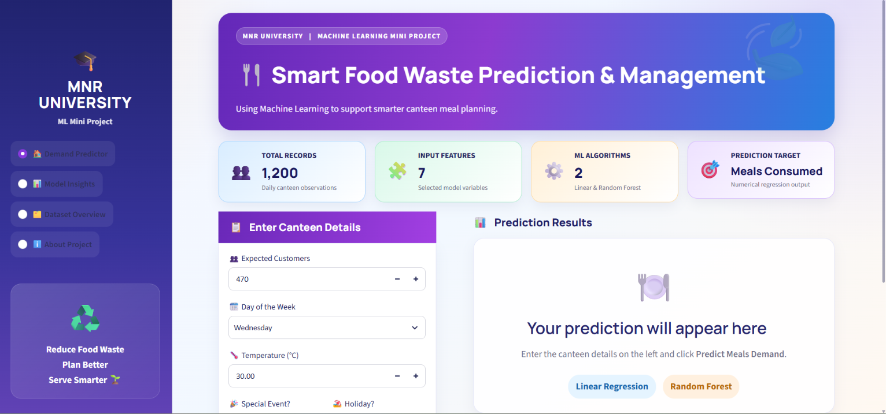
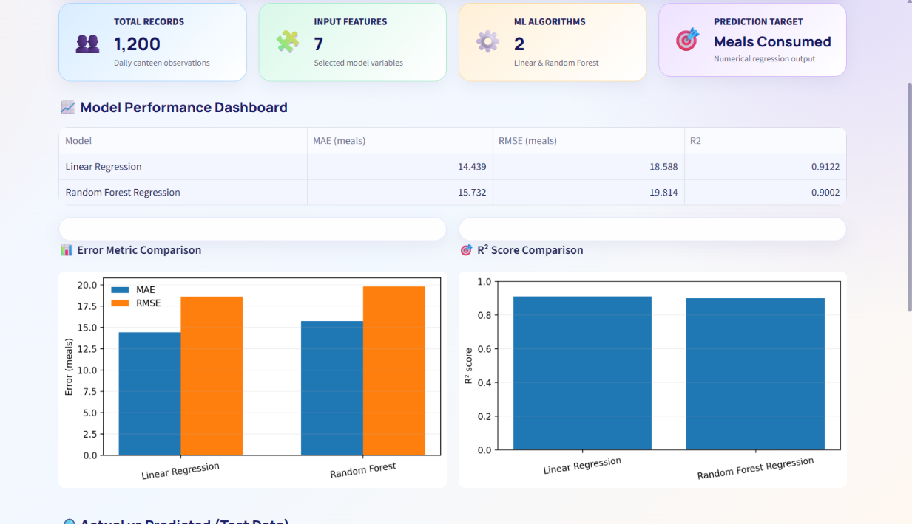
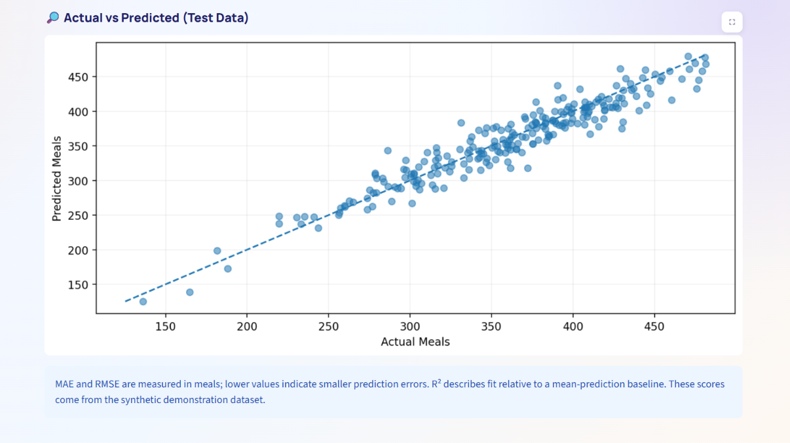
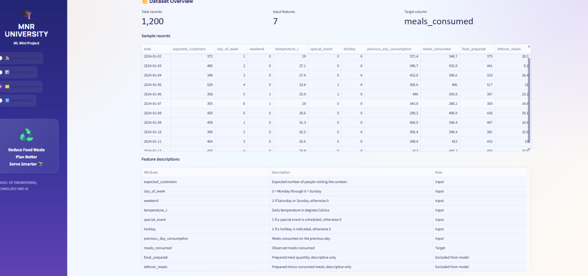
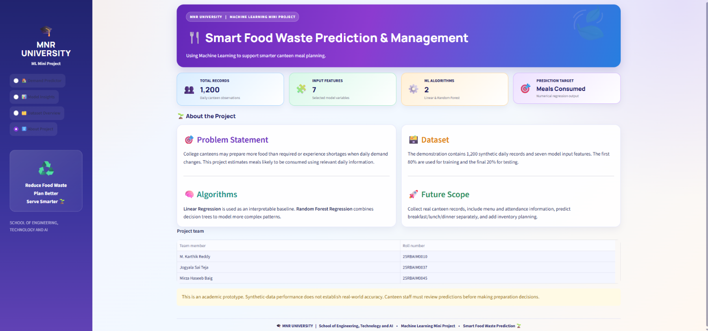

# Smart Food Waste Prediction and Management Using Machine Learning

A Streamlit-based academic mini project that estimates daily canteen meal demand using supervised machine learning. The prediction is intended to support food-preparation planning; it is not an automatic kitchen instruction.

> **Academic prototype notice:** The included 1,200-row dataset is synthetic and was generated programmatically. The reported metrics demonstrate the workflow on this synthetic dataset only; they do not establish real-world accuracy for MNR University or any other canteen.

## Project information

| Item | Details |
|---|---|
| Institution | MNR University |
| School | School of Engineering, Technology and AI |
| Course | Machine Learning (25CSM201) |
| Project type | Supervised machine learning – regression |
| Prediction target | Daily meals consumed (`meals_consumed`) |

## Team members

| Name | Roll number |
|---|---|
| M. Karthik Reddy | 25RBAIM0010 |
| Jogyala Sai Teja | 25RBAIM0037 |
| Mirza Haseeb Baig | 25RBAIM0045 |

## Problem statement

College canteens may prepare too much or too little food when daily meal demand is estimated only from experience. Demand can change with expected customer count, day of the week, weekends, temperature, special events, holidays and previous-day consumption. This project uses those factors to estimate the number of meals likely to be consumed, helping canteen staff make more informed preparation decisions and potentially reduce avoidable leftovers.

## Main features

- Interactive Streamlit dashboard with four navigation pages: Demand Predictor, Model Insights, Dataset Overview and About Project.
- Daily meal-demand prediction using two regression models.
- Side-by-side model predictions for entered canteen conditions.
- Model evaluation using MAE, RMSE and R².
- Model comparison charts and an actual-versus-predicted visualization.
- Dataset preview, feature descriptions and project/team information.

## Dataset

- **File:** `data/canteen_data.csv`
- **Records:** 1,200 consecutive daily records, dated from 2024-01-01.
- **Source:** Generated by `src/train.py` using a fixed random seed (42); it is not an externally collected dataset.
- **Download:** The CSV is included directly in this repository. No separate download is required.

### Model input features

| Feature | Description |
|---|---|
| `expected_customers` | Expected number of people visiting the canteen |
| `day_of_week` | Day index: 0 = Monday through 6 = Sunday |
| `weekend` | 1 for Saturday/Sunday, otherwise 0 |
| `temperature_c` | Daily temperature in degrees Celsius |
| `special_event` | 1 when a special event is scheduled, otherwise 0 |
| `holiday` | 1 when a holiday is indicated, otherwise 0 |
| `previous_day_consumption` | Meals consumed on the previous day |

**Target:** `meals_consumed` — observed meals consumed on that day.

`food_prepared` and `leftover_meals` are included for descriptive analysis only. They are excluded from model inputs to avoid target leakage.

## Algorithms and methodology

1. **Linear Regression:** Used as an interpretable baseline for continuous meal-demand estimation. The training pipeline standardizes input features before fitting the regression model.
2. **Random Forest Regression:** Uses an ensemble of decision trees to model nonlinear relationships. The configured model uses 250 trees, a maximum depth of 12 and a minimum of 3 samples per leaf.

The records are kept in chronological order. The first 960 records (80%) are used for training and the final 240 records (20%) for testing. Both models use the same seven input features and the same split.

## Model results

The currently recorded evaluation results in `outputs/model_metrics.csv` are:

| Model | MAE (meals) | RMSE (meals) | R² |
|---|---:|---:|---:|
| Linear Regression | 14.439 | 18.588 | 0.9122 |
| Random Forest Regression | 15.732 | 19.814 | 0.9002 |

- **MAE (Mean Absolute Error):** Average absolute difference between actual and predicted meal counts. Lower is better.
- **RMSE (Root Mean Squared Error):** Square root of the average squared prediction error; it penalizes larger errors more strongly. Lower is better.
- **R² (coefficient of determination):** Measures fit relative to a mean-prediction baseline. It is not classification accuracy; a value closer to 1 indicates a stronger fit on this test set.

For this recorded run, Linear Regression has lower MAE and RMSE and a higher R² than Random Forest Regression. These results apply only to this synthetic demonstration dataset. Re-run `python src/train.py` if the code or dataset is changed, and use the newly generated metrics when reporting results.

### Important report consistency note

The supplied PDF report currently shows different evaluation values in its results section (page 11) and illustrative sample predictions (pages 12–13) from the values generated by the current repository code. The README and `outputs/` files above reflect the current repository run. Before final academic submission, revise the PDF report and presentation to use the same run's metrics and sample predictions, or restore the exact code/data that produced the report's original values. Do not present the two sets of numbers as if they came from one experiment.

## Application screenshots

### 1. Demand Predictor dashboard



### 2. Model Performance dashboard



### 3. Actual versus Predicted test data



### 4. Dataset Overview



### 5. About the Project and Team



## Repository structure

```text
Smart_Food_Waste_ML_Project/
├── app.py
├── requirements.txt
├── README.md
├── data/
│   └── canteen_data.csv
├── src/
│   └── train.py
├── models/
│   ├── linear_regression.joblib
│   └── random_forest_regression.joblib
├── outputs/
│   ├── model_metrics.csv
│   ├── metrics.json
│   ├── test_predictions.csv
│   ├── sample_prediction.json
│   ├── training_log.txt
│   └── charts (.png)
├── screenshots/
│   └── application screenshots (.png)
├── demo/
│   └── smart_food_waste_project_demo.mp4
├── docs/
│   └── Food_Waste_ML_Report_Final.pdf
└── presentation/
    └── Smart_Food_Waste_ML_Presentation.pptx
```

## Technologies used

- Python
- Streamlit
- Pandas and NumPy
- scikit-learn
- Matplotlib
- Joblib

## Installation and execution

**Recommended:** Python 3.10–3.12.

### 1. Clone the repository

```bash
git clone <YOUR_PUBLIC_GITHUB_REPOSITORY_URL>
cd <REPOSITORY_FOLDER_NAME>
```

### 2. Create and activate a virtual environment

```bash
python -m venv .venv
```

Windows PowerShell:

```powershell
.venv\Scripts\Activate.ps1
```

Windows Command Prompt:

```bat
.venv\Scripts\activate.bat
```

macOS/Linux:

```bash
source .venv/bin/activate
```

### 3. Install the dependencies

```bash
python -m pip install --upgrade pip
python -m pip install -r requirements.txt
```

### 4. Train the models and regenerate evaluation outputs

```bash
python src/train.py
```

This command regenerates the synthetic dataset, trains both models, saves model files under `models/`, and writes evaluation metrics, predictions and charts under `outputs/`.

### 5. Run the Streamlit application

```bash
python -m streamlit run app.py
```

Open the local address printed in the terminal (normally `http://localhost:8501`).


> **Documentation consistency:** The report and presentation have been refreshed to use the saved evaluation values in `outputs/metrics.json` and `outputs/model_metrics.csv`. The dataset is synthetic; these metrics are demonstration results, not real-canteen validation.

## Project demo video

Watch the project demonstration using the Google Drive link below:

**[▶ Watch the Smart Food Waste project demo on Google Drive](https://drive.google.com/file/d/1zlZracwZ8w8nvM0B6TCRwEgF86OyYQ_B/view?usp=sharing)**

The MP4 video is also included in this repository:

**[Open / download the project demo (MP4)](demo/smart_food_waste_project_demo.mp4)**

- Format: MP4
- Duration: approximately 57 seconds
- Resolution: 1908 × 972

**Access note:** The Google Drive file's General access must be set to **Anyone with the link — Viewer** so faculty can watch it without requesting permission. Test the link in an Incognito/Private browser window while logged out.

## Limitations

- The dataset is synthetic and does not prove real-world model performance.
- Prediction quality depends on accurate and consistent historical records.
- Sudden timetable changes, weather events or supply disruptions may change demand.
- Daily totals do not model demand for individual menu items.
- Human review is required; the application does not issue automatic kitchen-preparation instructions.

## Future scope

- Collect verified daily canteen records and retrain/evaluate the models.
- Add menu, price, attendance and examination-calendar information.
- Predict breakfast, lunch and dinner demand separately.
- Add inventory planning and prediction uncertainty estimates.
- Monitor model error over time and retrain when demand patterns change.

## Academic submission checklist

- [x] Source code included (`app.py`, `src/train.py`).
- [x] Dataset included (`data/canteen_data.csv`).
- [x] Dependency list included (`requirements.txt`).
- [x] Project report included (`docs/`).
- [x] Presentation included (`presentation/`).
- [x] README includes project, team, dataset, algorithms, setup, results and screenshots.
- [x] Demo video included (`demo/smart_food_waste_project_demo.mp4`).
- [ ] GitHub repository visibility set to **Public**.
- [ ] Public access verified in an Incognito/Private browser window while logged out.

## Team's final GitHub checks

1. Push the complete project contents to the repository (do not upload only the ZIP file).
2. In GitHub, open **Settings → General → Danger Zone → Change repository visibility → Make public**.
3. Copy the repository URL and open it in an Incognito/Private browser window without signing in.
4. Confirm the README screenshots render and the report, presentation, dataset and source files can be opened.
5. Add the demo video link once the recording has been uploaded.

## Demo video

**[▶ Watch the Smart Food Waste project demo on Google Drive](https://drive.google.com/file/d/1zlZracwZ8w8nvM0B6TCRwEgF86OyYQ_B/view?usp=sharing)**

The MP4 demonstration is also included in this repository:
[`demo/smart_food_waste_project_demo.mp4`](demo/smart_food_waste_project_demo.mp4)

If the Drive link requests access, set Google Drive sharing to **Anyone with the link — Viewer**. The video file in this repository can also be downloaded directly from GitHub.

